opencode -s ses_f8ebc7da2ffe6MGlDbnVLpSk81

# RealDeal Logistics Operations System

> A full-stack logistics platform for managing orders, dispatch, warehouse, payments, finance, and back-office operations — built with Laravel 12 + React + Inertia.js.

   

---

## Overview

RealDeal is a logistics operations platform that centralises everything from order import to final payment remittance. Teams across dispatch, warehouse, finance, and communication all work from the same system, with role-based access controlling what each user can see and do.

**Who uses it:**

| Role | What they do |
|------|-------------|
| **Admin / G.O.D** | Full access across all countries and modules |
| **Finance** | Budget management, requisitions, report generation, remittance tracking |
| **Dispatch Agent** | View assigned orders, generate waybills, mark deliveries |
| **Warehouse** | Product management, barcode scanning, stock transfers |
| **Merchant** | View and confirm their own orders via the finance workflow |
| **Call Center** | WhatsApp/chat conversations, STK push, customer communication |

---

## Tech Stack

| Layer | Technology |
|-------|-----------|
| Backend | Laravel 12, PHP 8.2+ |
| Frontend | React 19, TypeScript |
| Bridge | Inertia.js + Ziggy |
| Styling | Tailwind CSS v4, Radix UI |
| Build | Vite |
| Database | MySQL (via Eloquent ORM) |
| PDF | barryvdh/laravel-dompdf |
| Excel | maatwebsite/excel |
| Barcodes | milon/barcode |

---

## System Architecture

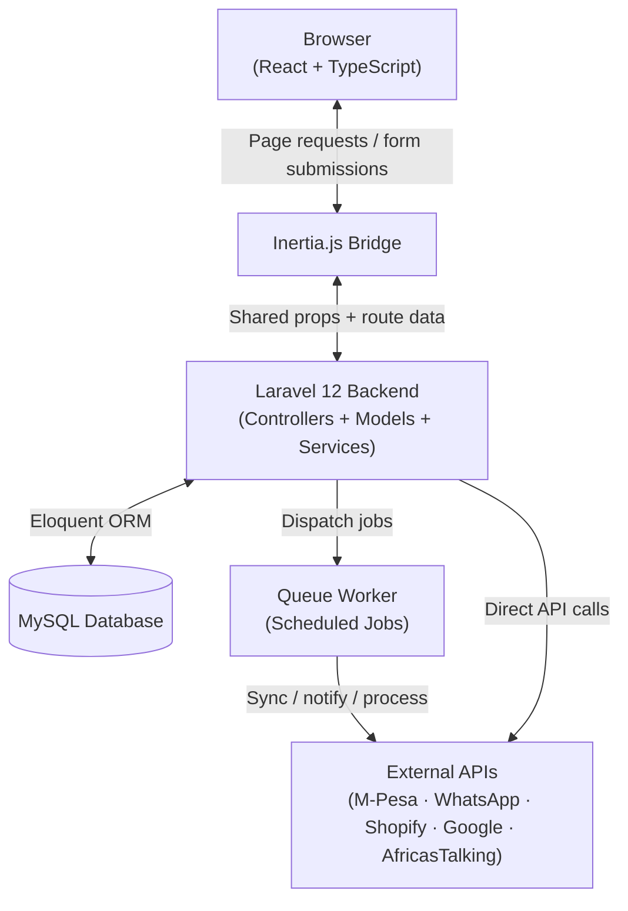

---

## Project Structure

```
├── app/
│   ├── Console/
│   │   └── Commands/          # Scheduled & CLI commands
│   ├── Exports/               # Excel/CSV export classes
│   ├── Http/
│   │   ├── Controllers/       # 40+ controllers (web + API)
│   │   ├── Middleware/         # Custom middleware
│   │   └── Requests/          # Form request validation
│   ├── Jobs/                  # Queueable jobs
│   ├── Models/                # 35 Eloquent models
│   ├── Providers/             # Service providers
│   ├── Services/              # Business logic services
│   └── Support/               # Helpers (CountryAccess, etc.)
├── config/                    # Laravel config files
├── database/
│   ├── migrations/            # 23 schema migrations
│   ├── factories/             # Model factories
│   └── seeders/               # Database seeders
├── resources/
│   ├── js/                    # React frontend
│   │   ├── components/        # Reusable UI components
│   │   ├── hooks/             # Custom React hooks
│   │   ├── layouts/           # Layout components
│   │   ├── lib/               # Utility functions
│   │   ├── pages/             # Inertia page components
│   │   └── types/             # TypeScript type definitions
│   └── views/                 # Blade templates
├── routes/
│   ├── web.php                # Web routes (Inertia pages)
│   ├── api.php                # API routes (webhooks, integrations)
│   ├── auth.php               # Auth routes
│   └── settings.php           # Settings routes
└── tests/                     # PHPUnit tests
```

---

## Modules & Workflows

### 1. Order Lifecycle

Orders start as raw CSV/Excel data and move through dispatch, delivery, and monitoring until they are fully remitted.

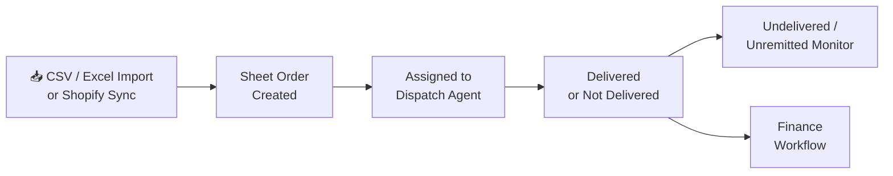

**Key pages:** `import`, `sheetorders`, `dispatch`, `undelivered`, `unremitted`

**Controllers:** `ImportController`, `SheetOrderController`, `DispatchController`, `UndeliveredController`, `UnremittedController`

---

### 2. Finance Workflow

Once an order is delivered, it moves through a four-stage finance pipeline tracked with timestamps and user IDs at every step.

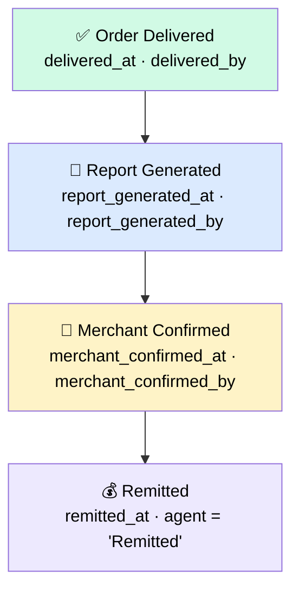

Each stage is gated — you cannot skip steps. Finance staff mark delivery and generate reports; merchants confirm; finance finalises remittance.

**Key pages:** `finance-workflow`

**Controller:** `FinanceWorkflowController`

---

### 3. Payment Collection (STK Push / M-Pesa)

Agents initiate mobile payments directly from the system, which talks to M-Pesa and waits for the payment callback.

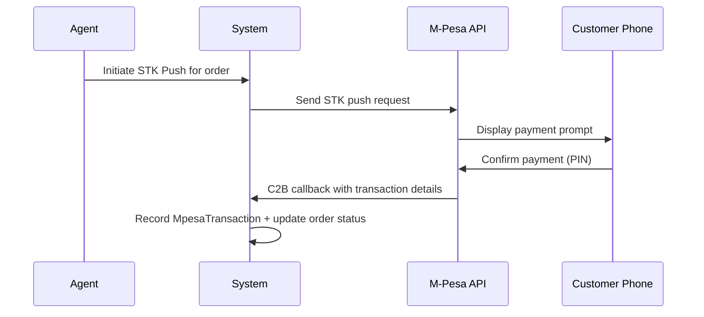

**Key pages:** `stk`

**Controllers:** `StkController`, `C2BTransactionController`

**Console Commands:** `ProcessC2BTransactions`

---

### 4. Inventory & Warehouse

Products are tracked from creation through barcode scanning, stock updates, agent transfers, and deductions.

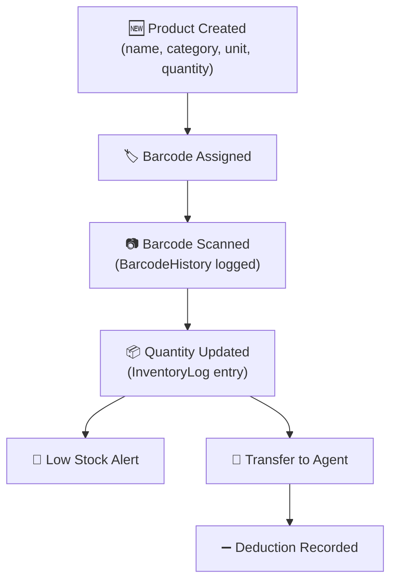

**Key pages:** `products`, `transfer`, `waredash`, `inventory-deductions`

**Controllers:** `ProductController`, `TransferController`, `InventoryDeductionController`, `WaredashController`

**Services:** `ProductStockAlertService`

---

### 5. Inventory Deduction Workflow

When delivered orders need inventory deducted from merchant stock:

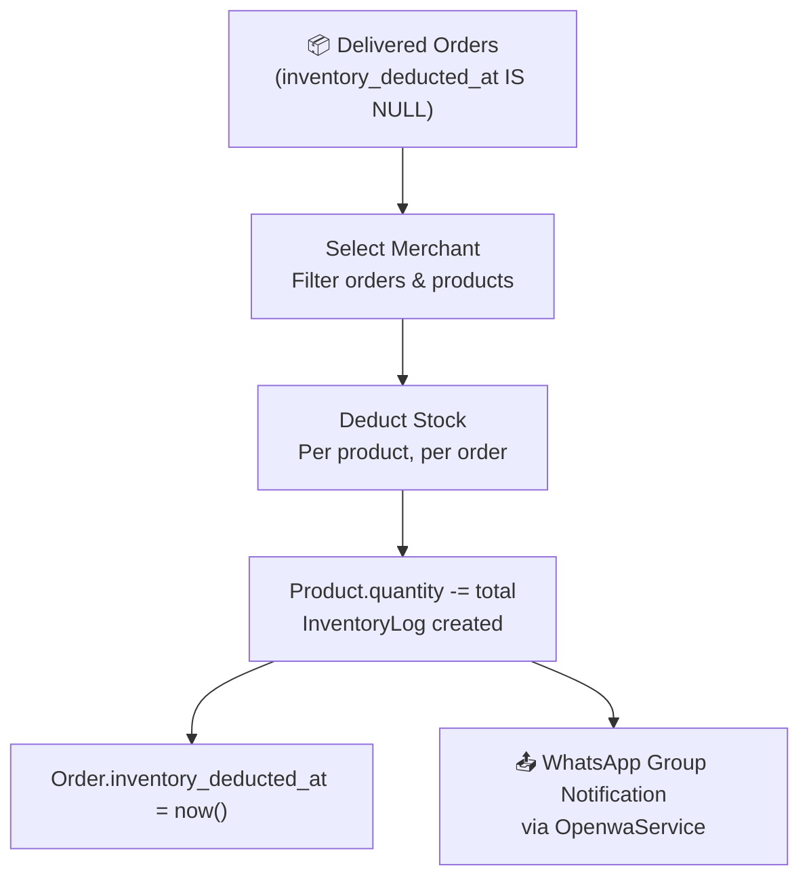

**Key pages:** `inventory-deductions`

**Controller:** `InventoryDeductionController`

---

### 6. Requisition & Budget Approval

Finance teams create requisitions that go through an approval chain before being paid out from a daily budget.

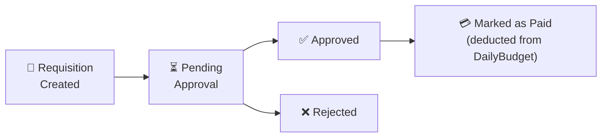

Budgets have daily limits and can receive top-ups. Requisitions link to a `RequisitionCategory` and are associated with specific budget lines.

**Key pages:** `requisitions`, `budgets`

**Controllers:** `RequisitionController`, `RequisitionCategoryController`, `DailyBudgetController`

---

### 7. Communication (WhatsApp & Voice)

RealDeal has a **layered WhatsApp messaging system** with multiple providers:

```mermaid
flowchart TD
    subgraph Inbound
        W_In["📱 Inbound WhatsApp"]
        Webhook["🔗 Webhook\n(WASender / AfricasTalking)"]
        Store["💾 Chat Record"]
    end

    subgraph Chat UI
        Agent["👤 Agent Views\nChat Interface"]
        Reply["💬 AgentSends Reply"]
    end

    subgraph Outbound
        WS["Wasender API\n(primary)"]
        WAWP["WAWP API\n(fallback)"]
        OWA["OpenWA\n(self-hosted)"]
    end

    subgraph Group Notifications
        LSA["Low Stock Alert"]
        IDN["Inventory Deduction"]
        STN["Stock Transfer"]
        SDN["Stock Deduction"]
    end

    W_In --> Webhook --> Store --> Agent --> Reply

    Reply --> WS -->|"fails"| WAWP
    Reply --> OWA

    LSA --> OWA
    IDN --> OWA
    STN --> OWA
    SDN --> OWA
```

**Providers:**

| Provider | Role | Used By |
|----------|------|---------|
| **Wasender** | Primary outbound (chat replies) | `WhatsAppFallbackService`, `WhatsappController` |
| **WAWP** | Fallback (if Wasender fails) | `WhatsAppFallbackService` |
| **OpenWA** | Group notifications, fallback chat | `OpenwaService`, `WhatsappController` |

**Key pages:** `whatsapp`

**Controllers:** `WhatsappController`, `ChatController`

**Services:** `OpenwaService`, `WhatsAppFallbackService`

**Console Commands:** `SendWhatsAppMessage`

#### WhatsApp Group Notifications

Automated notifications are sent to country-specific WhatsApp groups instead of individual numbers:

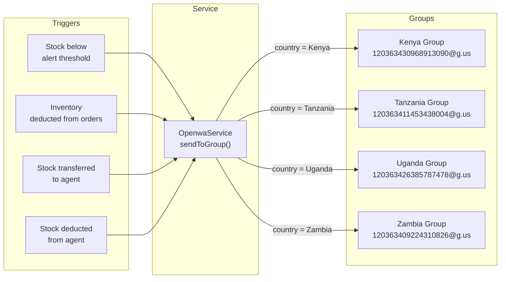

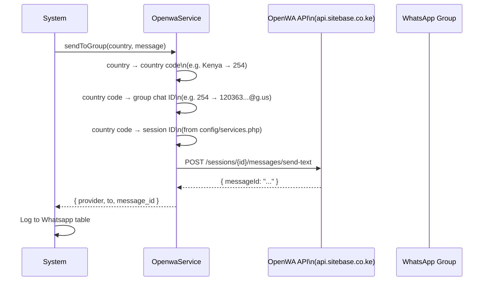

**Services involved:**
- `OpenwaService` — shared service used by `ProductStockAlertService`, `InventoryDeductionController`, and `TransferController`
- `ProductStockAlertService` — low stock threshold alerts
- `WhatsAppFallbackService` — Wasender → WAWP fallback for chat replies

---

### 8. Reports & Monitoring

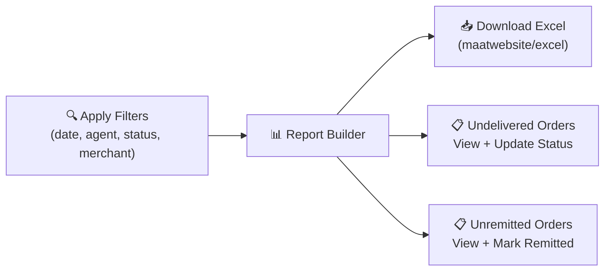

**Key pages:** `report`, `undelivered`, `unremitted`, `stats`

**Controllers:** `ReportController`, `StatsController`

**Services:** `DashboardReportService`, `StatsReportService`

---

### 9. Order Scanning (Warehouse Outbound/Inbound)

Warehouse staff scan product barcodes to process inbound and outbound operations:

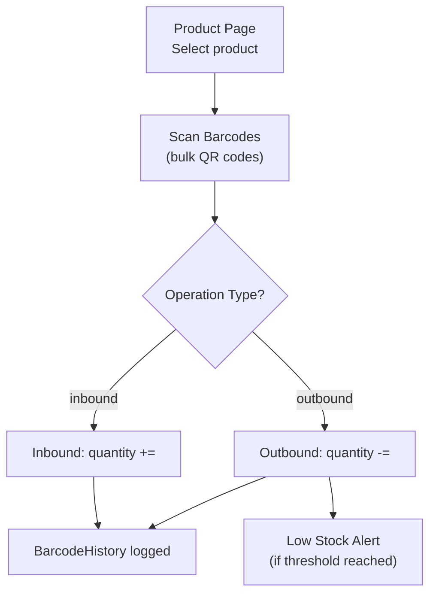

**Controllers:** `ProductController` (scanBarcodes method), `OrderScanController`

---

### 10. Dispatch & Waybills

Orders are assigned to dispatch agents who generate waybills and manage deliveries:

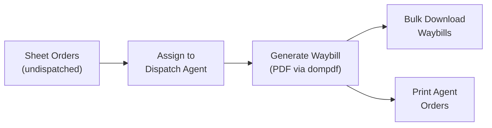

**Controllers:** `DispatchController`, `WaybillController`

---

## Multi-Tenancy (Country Isolation)

Every user belongs to a `Country`. All queries are automatically scoped to the user's country via the `CountryAccess` helper class — users can only see data for their own country.

The **G.O.D** (admin) role bypasses country scoping and has global access across all countries.

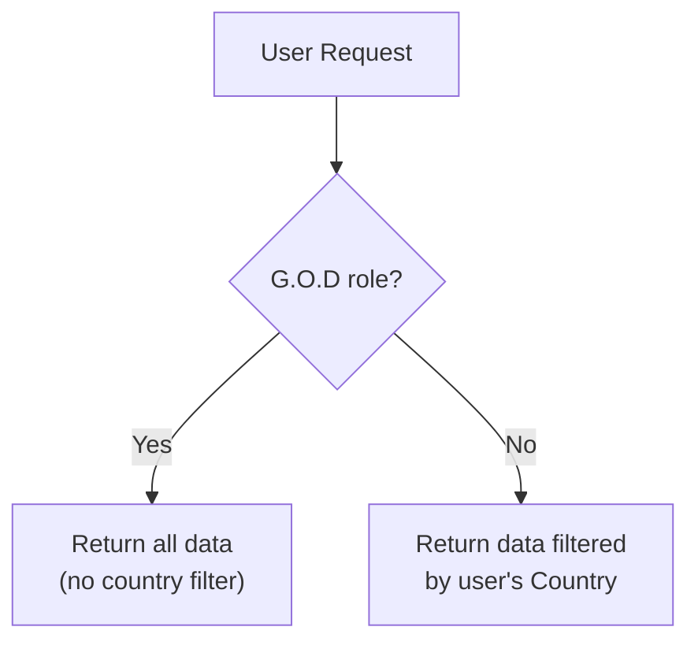

**Supported countries:**

| Country | Code | OpenWA Session Env Var |
|---------|------|------------------------|
| Kenya | 254 | `OPENWA_SESSION_KENYA` |
| Tanzania | 255 | `OPENWA_SESSION_TANZANIA` |
| Uganda | 256 | `OPENWA_SESSION_UGANDA` |
| Zambia | 260 | `OPENWA_SESSION_ZAMBIA` |

---

## Role-Based Sidebar

The navigation menu is dynamically controlled per role. Admins configure which menu items each role can see via the **Sidebar Permissions** page. This is stored in `SidebarRolePermission` and delivered to the frontend via Inertia shared props.

---

## Services Layer

| Service | Purpose |
|---------|---------|
| `OpenwaService` | Shared OpenWA messaging — sends to country groups or individual numbers |
| `WhatsAppFallbackService` | Wasender primary → WAWP fallback for chat replies |
| `ProductStockAlertService` | Low stock alerts via OpenWA groups |
| `DashboardReportService` | Dashboard statistics and charts |
| `StatsReportService` | Reporting and analytics |
| `SheetOrderImportService` | CSV/Excel import processing |
| `ShopifyService` | Shopify order sync |

---

## Key Integrations

| Integration | Purpose |
|-------------|---------|
| **M-Pesa (Daraja)** | STK push payment collection, C2B callbacks |
| **WASender** | WhatsApp messaging (inbound + outbound, primary) |
| **OpenWA (WaZuri)** | WhatsApp group notifications + fallback messaging |
| **WAWP** | WhatsApp fallback provider |
| **AfricasTalking** | SMS / voice / telecom integrations |
| **Shopify** | Order sync from merchant stores |
| **Google API** | Google Sheets / Drive integrations |

---

## Data Model (Key Tables)

| Table | Purpose |
|-------|---------|
| `countries` | Supported countries |
| `users` | All users with role and country assignment |
| `products` | Inventory products with quantity tracking |
| `sheet_orders` | Core order table with finance workflow columns |
| `incoming_sheet_orders` | Pre-processed imported orders |
| `sheets` | Merchant sheet groupings |
| `transfers` | Stock transfers to agents |
| `deductions` | Stock deductions from agents |
| `barcodes` | Scanned barcode history |
| `inventory_logs` | Quantity change audit trail |
| `stk` | STK push payment records |
| `mpesa_transactions` | M-Pesa C2B callback records |
| `c2b_transactions` | C2B transaction records |
| `requisitions` | Finance requisitions |
| `daily_budgets` | Daily budget tracking |
| `chats` / `whatsapp` | WhatsApp conversation records |
| `sidebare_role_permissions` | Dynamic sidebar visibility config |
| `dispatch` | Dispatch agent assignments |
| `voice_calls` | Voice call records |
| `user_locations` | Agent location tracking |

---

## Scheduled Background Jobs

The system runs automated tasks via Laravel's scheduler and queue workers:

| Command | Schedule | Purpose |
|---------|----------|---------|
| `orders:pull-sheets` | Every minute | Poll selected tabs on enabled spreadsheets and queue eligible orders |
| `orders:update-sheets --limit=250` | Every 5 minutes | Write order updates back to merchant spreadsheets |
| `storeep:sync-orders` | Every 5 minutes | Reconcile orders from enabled Storeep integrations |
| `whatsapp:send-meta` | Daily at 06:00 | Send scheduled WhatsApp messages |
| `whatsapp:notify-overdue` | Daily at 07:00 | Send overdue-order notifications |

---

## Development Setup

```bash
# Install dependencies
composer install
npm install

# Environment setup
cp .env.example .env
php artisan key:generate

# Database
php artisan migrate

# Start development servers (Laravel + Queue + Vite concurrently)
composer run dev
```

> `composer run dev` starts the Laravel server, queue worker, and Vite dev server concurrently.

### Automatic Google Sheets Order Pickup

#### Configuration and eligibility

On the **Sheets** page, edit a spreadsheet to enable automatic pickup and select the tabs to poll. Both the spreadsheet toggle and selected tab list are required; existing spreadsheets are disabled by default. Settings are stored on the spreadsheet record by the migration `2026_10_26_120000_add_automatic_order_pickup_to_sheets_table`.

Automatic pickup accepts a row only when its status is blank, the physical third column (C) is nonblank, and its order data passes validation and duplicate checks. For automatically polled rows and Apps Script submissions, `order_date` is the date the order first enters the system. Manual Google Sheets pulls and CSV/Excel imports retain their previous date behavior.

#### Scheduling, cursors, and queue processing

Laravel schedules `orders:pull-sheets` every minute. Each run rotates through configured spreadsheet-tab pairs, reading at most 20 tabs and staging at most 250 orders by default. These limits can be changed with `--tab-limit` and `--order-limit`. A command lock prevents overlapping poller runs; it does not prevent other scheduled commands from running at the same time.

The poller keeps two positions in Laravel's configured cache:

- A global tab cursor selects where to resume in the ordered list of enabled tabs on the next run, then wraps around to the start.
- A separate row-window cursor for each spreadsheet and tab starts at row 1, advances by 5,000 rows after a completed window, and cycles back to row 1 after reaching the end. Cycling allows older rows to be rechecked for later edits. These positions are cache entries, not a visible per-order processing history; clearing the cache resets them.

When a tab read fails (for example, because its service account lacks access or Google rejects a request), that tab's row cursor is not advanced. The command logs the error and retries with exponential backoff capped at approximately 64 seconds (plus jitter); a successful poll clears the retry state. Check `storage/logs/laravel.log` for poll success/error entries. A persistent access error must be fixed by granting the configured read-only service account access to that spreadsheet.

Eligible rows are staged in `incoming_sheet_orders` and dispatched as jobs to the `imports` queue. The scheduler only discovers and stages orders; a queue worker must be running to create the corresponding application orders. Review pending/failed incoming rows in the application's incoming sheet orders workflow.

The poller uses the read-only Google Sheets reader service account configured by `GoogleSheetsReader`. The separate `orders:update-sheets` command writes updates using its existing write credential. These tasks can be scheduled near each other; their individual locks prevent duplicate concurrent runs of the same command, not all cross-command API activity.

#### Capacity planning for hundreds of sheets

Capacity is determined by the number of **enabled tabs**, not just the number of spreadsheet records. With 500 active tabs and the default limit of 20 tabs per run:

- At the current one-minute schedule, one pass takes about 25 runs (approximately 25 minutes), assuming runs finish, the order cap is not reached, and no tabs are repeatedly failing.
- At a seven-minute schedule, one pass takes about 25 runs (approximately 175 minutes). A new order can wait up to roughly one full pass to be discovered.
- A poll of a tab can use one Sheets read for its current 5,000-row window; windows after the first also read the first five rows for header detection. Other integrations and outbound writes consume quota too, so these estimates are not a quota guarantee.

Keep the one-minute schedule as the initial setting if order pickup latency matters, and monitor API errors, runtime, queue depth, and pickup delay as enabled tabs increase. The existing 20-tab batch is a pacing control; simply increasing it can increase API pressure. If 500 tabs need lower latency than a roughly 25-minute sweep, the polling design and request budget should be load-tested and tuned rather than just changing the schedule interval.

#### Known limitation before broad rollout

The row-window cursor advances only when the importer reports no more eligible orders in the current window. If a single window contains more new eligible orders than the run's remaining order budget, the cursor stays on that window. On a later run the same window can be revisited and pending staged rows can be requeued, potentially consuming the limit repeatedly before later rows are reached. This edge case has not been fixed or verified for high-volume tabs; validate/fix cursor advancement and add command-level regression coverage before relying on the poller at large scale.

#### Operations and targeted test

The production scheduler must invoke `php artisan schedule:run` every minute (or use `php artisan schedule:work` for local testing). Keep a queue worker listening to `imports`.

Run one poll immediately:

```bash
php artisan orders:pull-sheets
```

Restrict a test to one spreadsheet and use low limits:

```bash
php artisan orders:pull-sheets --sheet-id=<spreadsheet-id> --tab-limit=4 --order-limit=5
```

The command prints per-run tab/order totals. Detailed per-tab counts and errors are written to the Laravel log; it does not currently provide a UI view of the saved cursor or last scanned row. A targeted test run in this implementation session scanned four configured OPULYNIX tabs, staged five orders (one from `GALAXY PROJECTOR2026`, four from `TORLAM MATHS BOOK2026`), and reported no tab failures. Those orders were pending queue processing at the time of verification.

### Linting & Type Checking

```bash
npm run lint        # ESLint
npm run types       # TypeScript type check
npm run format      # Prettier
composer run test   # PHPUnit
```

---

## Notes

- Authentication and shared frontend state are handled through Inertia middleware (`HandleInertiaRequests`)
- The app supports both web routes (Inertia pages) and API endpoints (for webhooks and external integrations)
- Role-based access covers not just UI visibility but also controller-level guards
- All finance workflow steps are immutable audit trails — timestamps and user IDs are recorded and never overwritten
- WhatsApp notifications are routed through `OpenwaService` which maps country names → country codes → group chat IDs → OpenWA session IDs
- The `ProductStockAlertService` uses constructor injection for `OpenwaService` — Laravel's service container auto-resolves it
